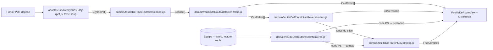

# 09 — Feuille de route : lecture des séances Vega et reversements

L'écran **Feuille de route** (`/feuille-de-route`) lit la « Liste des séances sur une période » exportée de **Vega** (PDF), repère les patients soignés le même jour par **plusieurs infirmières**, et calcule **qui reverse combien à qui**. Tout se passe dans le navigateur : rien n'est envoyé, rien n'est conservé.

Historique des décisions : [feature 0033](../../features/0033-feuille-de-route.md), [feature 0034](../../features/0034-initiales-vega-et-reversements.md), [feature 0035](../../features/0035-bilan-qui-doit-quoi.md), [feature 0036](../../features/0036-retrocession-flux-bilan.md). Choix des bibliothèques : [ADR 0019](../adr/0019-lecture-pdf-pdfjs.md) (pdf.js).

## Chaîne de traitement



| Étape | Module | Nature | Rôle |
|---|---|---|---|
| Lecture | `src/adaptateurs/lireGlyphesPdf.js` | I/O navigateur (hors domaine) | `File` → fragments de texte positionnés `{page, x, y, largeur, str}`. pdf.js chargé **à la demande** (chunk + worker séparés). |
| Extraction | `src/domain/feuilleDeRoute/extraireSeances.js` | pur | fragments → séances `{date, ps, heure, patient, cotation, montantCentimes, fin}` + période. |
| Détection | `src/domain/feuilleDeRoute/detecterRelais.js` | pur | séances → cas, parts, reversements. |
| Bilan | `src/domain/feuilleDeRoute/bilanReversements.js` | pur | cas → cumul par code PS (touché, part, solde) et virements à faire sur la période. |
| Liaison | `src/domain/feuilleDeRoute/relierInfirmieres.js` | pur | code PS → personne via `Personne.initialesVega` ; code PS → compte (titulaire de référence) via `compteDuCode` [0036]. |
| Flux | `src/domain/feuilleDeRoute/fluxComptes.js` | pur | lignes du bilan → comptes de titulaires, virements entre comptes, rétrocessions, alertes [0036]. |
| Affichage | `src/views/FeuilleDeRouteView.vue`, `src/components/feuilleDeRoute/` | UI | états attente / analyse / erreur / résultat. Aucune logique métier. |

Les modules de `src/domain/feuilleDeRoute/` n'utilisent que des **imports relatifs** (pas d'alias `@/`) pour rester exécutables tels quels par Node lors des vérifications.

## Format Vega attendu

Le PDF est un tableau, écrit glyphe par glyphe, que pdf.js restitue en fragments (mots ou cellules entières) avec leur position.

- **Ligne d'en-tête** (répétée à chaque page) : `PS · Heure · Bénéficiaire · Cotation · Montant · Actes · Nuit · Dim · IF · Km · IK · DE · Facture · Fin`. Elle est reconnue si elle contient au moins `PS, Heure, Bénéficiaire, Cotation, Montant, Fin` ; l'abscisse de chaque intitulé définit le début de sa colonne.
- **Ligne de jour** : `Jeudi 08/10/2026` → date courante `2026-10-08` (date calendaire réellement valide, sinon ignorée avec les séances qui suivent).
- **Ligne de séance** : PS sur 2 à 4 caractères `[A-Z0-9]` (`FC`, `LR`, `EMM`…) + heure `HH:mm`.
- Ignorés : pieds de page (`Vega5 … Imprimé le … Page N`), totaux (`N séances pour un total de …`).

Règles d'extraction :

- Fragments regroupés en **lignes** par page et par `y` (tolérance `TOLERANCE_LIGNE` = 1,5 pt), fragments blancs écartés.
- Chaque fragment va dans la **dernière colonne connue** dont le début − `TOLERANCE_COLONNE` (2 pt) ≤ son `x`. Les colonnes viennent d'une **liste blanche** : le texte du PDF ne crée jamais de colonne (sinon « Cotation » avalerait Montant, Actes…).
- **Montant** (`20,95`) → centimes entiers (`2095`), parse strict `^\d{1,6},\d{2}$`, sinon `null`. C'est la colonne **Montant** (total de la ligne) qui compte, pas « Actes ».
- **Fin** (`dd/mm/yy`, fin de prise en charge) → `20yy-mm-dd`, `null` si absente ou invalide.

## Règle de détection

Pour chaque groupe **même date + même patient (normalisé) + même Fin** :

1. le groupe doit contenir au moins une séance dont la cotation commence par `BSA`, `BSB` ou `BSC` (soin de base) ;
2. **passages** = toutes les séances du groupe, triées par heure ; `N` = leur nombre (2 = matin + soir, 3 = matin + midi + soir) ;
3. le cas est signalé si au moins **deux codes PS distincts** y interviennent.

La **Fin** distingue deux prises en charge simultanées d'un même patient ; le **nom** distingue deux patients qui auraient la même Fin. Il n'y a **pas** de coupure horaire matin / après-midi : seule la position du passage donne son libellé (`libelleMoment` : Matin / Soir, Matin / Midi / Soir, sinon « Passage n »).

## Séances barrées

Vega barre une séance (non faite) en dessinant sur chaque cellule un rectangle plein très fin (≈ 0,4 pt de haut) au milieu du texte. `lireGlyphesPdf` relève ces traits dans la liste d'opérateurs de chaque page (`getOperatorList`, boîtes de `constructPath` de 0,05 à 1,5 pt de haut ; les bordures du tableau, d'épaisseur nulle, sont écartées) et marque `barre: true` les fragments qu'ils traversent. `extraireSeances` en déduit `Seance.barree` ; `detecterRelais` ignore ces séances (conditions et calcul) et les rend dans `CasRelais.passagesBarres`, pour affichage seulement. Le résumé indique « dont N barrées dans Vega, ignorées ».

## Répartition et reversements

Dans la réalité, la Sécurité sociale paie **chaque ligne à l'infirmière de la ligne** : celle du matin touche le soin (BSx) + le déplacement (IFI), les passages suivants seulement le déplacement. Règle du cabinet [0037] : **seul le soin de base (BSA/BSB/BSC) est partagé**, à parts égales entre les **infirmières distinctes** du jour (quel que soit leur nombre de passages) ; IFI, AMI, majorations, IK restent à celle qui les a faits. La rétrocession d'une remplaçante ne porte donc que sur la part de BS (les autres soins s'annulent dans l'écart). Tous les calculs sont en **centimes entiers**.

La cotation Vega étant tronquée (« BSB1+IFI1 (… ») avec un seul montant par ligne, le montant du BS vient des tarifs NGAP `TARIFS_BS_CENTIMES` (BSA 13,00 · BSB 18,20 · BSC 28,70 €, vérifiés sur les totaux de pied de page du PDF) × coefficient. **À mettre à jour si les tarifs changent.**

| Grandeur | Calcul |
|---|---|
| `totalCentimes` | somme des montants du groupe (`null` si un montant est illisible, ou si une ligne est inférieure au tarif de son BS → `montantIncomplet`, ni parts ni reversements) |
| `bsCentimes` | Σ des BS du groupe (tarif × coefficient) ; `partBsCentimes` = `bs ÷ nb d'infirmières`, arrondi (affichage) |
| `partCentimes` | `touche − BS facturé par elle + sa part de BS` ; les centimes qui ne se divisent pas restent à celle(s) qui ont facturé le BS, pour que Σ parts = total |
| `toucheCentimes` | somme des montants de **ses** lignes |
| `ecartCentimes` | `touche − part` (positif = doit reverser) ; Σ écarts = 0 |
| `reversements` | glouton : le plus gros débiteur verse au plus gros créancier le minimum des deux, jusqu'à épuisement (déterministe, nombre de virements minimal en pratique) |

Exemples de référence (vérifiés sur les PDF de test) :

| Passages | Total | Parts | Touché | Reversement |
|---|---|---|---|---|
| FC 20,95 · LR 2,75 | 23,70 | FC 11,85 · LR 11,85 | FC 20,95 · LR 2,75 | FC → LR **9,10 €** |
| FC 20,95 · FC 2,75 · LR 2,75 | 26,45 | FC 14,60 · LR 11,85 | FC 23,70 · LR 2,75 | FC → LR **9,10 €** (moitié du BSB) |

## Bilan de la période

`calculerBilan(cas)` donne, pour tout le fichier, un seul « qui doit quoi » (comme un Tricount), calculé à la volée et jamais conservé.

- **Cumul** : par code PS (`Map`), on additionne `nbPassages`, `toucheCentimes` et `partCentimes` des `PartRelais` de chaque cas retenu ; `soldeCentimes = touché − part` (> 0 : doit reverser). Aucun nouvel arrondi : on additionne des centimes déjà arrondis cas par cas, donc le bilan est exact au centime et cohérent avec le détail. Invariants : Σ parts = Σ touchés = total ; Σ soldes = 0.
- **Exclusion** : les cas `montantIncomplet` ne sont pas comptés ; le bilan ne donne que leurs **jours** (`datesCasExclus`), jamais un nom de patient.
- **Virements** : `calculerReversements` réutilisé tel quel sur les soldes (lignes triées par code, résultat déterministe). Des reversements opposés s'annulent ; au plus (n − 1) virements pour n soldes non nuls.
- **Codes non reliés** : comptés sous leur code.
- **Un bilan par fichier** : `couvrePlusieursMois(periode)` signale un fichier à cheval sur plusieurs mois civils.
- **Affichage (0036)** : `bilan.virements` (code à code) est toujours calculé mais n'est plus affiché ; l'écran montre les virements **entre titulaires** (voir ci-dessous).

### Comptes et rétrocession [0036]

Au cabinet, l'argent des soins d'une remplaçante arrive sur le compte de **sa titulaire** (`Personne.titulaireId`, « Remplace en priorité »). `calculerFlux(lignes, resoudreCompte)` regroupe donc les soldes du bilan par **compte** : celui de la titulaire (ses codes + ceux de ses remplaçantes rattachées), ou celui de la personne elle-même (titulaire, remplaçante sans titulaire), ou `ps:<CODE>` pour un code non relié. Les virements entre comptes réutilisent `calculerReversements` tel quel.

Pour une remplaçante rattachée, de solde `s` (> 0 = doit reverser) et de taux de rétrocession `t` (entier 0..100) :

```
partRemplacante = Math.round(|s| × (100 − t) / 100)
partTitulaire   = |s| − partRemplacante
sens            = s < 0 ? RECOIT (la titulaire lui reverse la part) : PAIE (la titulaire retire la part de sa rétrocession habituelle)
```

On multiplie avant de diviser (produit entier) ; le demi-centime va à la remplaçante, la titulaire absorbe l'écart (somme exacte). Solde nul : aucune ligne.

Exemple de référence : lignes `CB +10,05`, `EMM +40,00`, `FC −20,00`, `SO −30,05` (Céline CB à 15 % chez Sandrine SO, Farah FC à 11 % chez Emmanuelle EMM) → 1 virement Emmanuelle → Sandrine **20,00 €** (au lieu de 3 code à code) ; rétrocessions : Sandrine retire 8,54 € de ce qu'elle reverse à Céline (elle prend 1,51 € à sa charge), Emmanuelle reverse 17,80 € à Farah (elle garde 2,20 €).

Alertes (`AlerteFlux`, une par code) : `SANS_TITULAIRE` (remplaçante sans titulaire : compte à part), `SANS_TAUX` (rétrocession listée sans montant), `CODE_INCONNU` (code non relié : compte à part). Chaque alerte de l'écran (titre « À corriger dans l'onglet Équipe », lien « Compléter la fiche » ou « Relier ce code dans Équipe ») mène à la fiche (`/equipe?modifier=<id>&champ=remplacement`, personne active) ou à Équipe. L'écran affiche, de haut en bas : tableau, virements entre titulaires, section « À ajouter ou retirer sur le reversement habituel aux remplaçantes » (ces sommes ne sont pas des virements en plus), alertes ; le détail par patient renvoie au bilan par un encart (« Ne faites pas ces virements »).

## Liaison avec l'équipe

Le code PS est relié à une personne par `Personne.initialesVega` (casse ignorée ; en cas de doublon, la personne active l'emporte). Depuis 0036, deux champs de la fiche comptent pour le bilan : `titulaireId` (compte qui reçoit l'argent d'une remplaçante) et `tauxRetrocession` (part gardée par la titulaire) ; obligatoires à la saisie pour une remplaçante, mais les données antérieures non migrées sont **signalées** par les alertes du bilan, jamais corrigées. Affichage « Prénom Nom (FC) », ou le code seul avec la mention « code Vega non relié à l'équipe » ; un encart liste les codes non reliés avec un lien vers Équipe. Les mêmes initiales servent de repère dans les pastilles de personne et sur le planning imprimé (à défaut : première lettre du prénom).

## Sécurité et confidentialité

Le PDF contient des **données de santé** (noms de patients) et est un **fichier non fiable**.

- **Rien n'est conservé** : ni le fichier, ni les fragments, ni les séances ; la vue ne garde en mémoire que ce qu'elle affiche, perdu en quittant la page. Pas de Vuex, pas de `storageRepository`, aucun `console.*`.
- **Rien n'est envoyé** : pdf.js reçoit les octets en mémoire ; `cMapUrl`, `standardFontDataUrl`, `wasmUrl` à `null` ; seuls le chunk pdf.js et son worker sont chargés, depuis l'origine du site.
- **Durcissement pdf.js** : `isEvalSupported: false`, `enableXfa: false`, `stopAtErrors: true`, `disableAutoFetch`, `disableStream`, extraction de texte uniquement (aucun rendu).
- **Plafonds** : 20 Mo (`TAILLE_MAX_PDF_OCTETS`), 200 pages (`NB_PAGES_MAX`), 200 000 fragments (`NB_FRAGMENTS_MAX`).
- **Robustesse** : toute la chaîne est sous un seul `try/catch` (l'écran ne reste jamais bloqué en « Lecture… ») ; le texte du PDF n'indexe jamais d'objet littéral (`Map` + liste blanche) ; rendu par interpolation uniquement (pas de `v-html`).
- Les exports Vega et les sauvegardes réelles vivent dans `files/`, ignoré par git.

Codes d'erreur affichés (messages dans `FeuilleDeRouteView.vue`) : `PLUSIEURS_FICHIERS`, `PAS_PDF`, `TROP_VOLUMINEUX`, `PDF_ILLISIBLE`, `PDF_TROP_COMPLEXE`, `AUCUNE_SEANCE`, `LECTEUR_INDISPONIBLE`.

## Limites connues

- **Dépendance au format Vega** : un changement de mise en page (intitulés de colonnes, format des lignes de jour) peut rendre la lecture impossible → erreur `AUCUNE_SEANCE`, jamais un résultat faux silencieux pour une colonne absente.
- Un fichier à la fois ; pas de cumul sur plusieurs exports. Un bilan par fichier : exporter un mois à la fois pour un bilan mensuel.
- Pas de CSP posée sur le site : la garantie « rien n'est envoyé » repose sur le code, pas sur le navigateur.

## Vérifier après une modification

Pas de test runner : `npm run build`, puis un script Node jetable **hors dépôt** qui lit un PDF avec `pdfjs-dist/legacy/build/pdf.mjs` (mêmes options que l'adaptateur), construit les fragments comme l'adaptateur et appelle `extraireSeances` + `detecterRelais`. Attendus sur les PDF de test de `files/` : `Vega_UnDoublon.pdf` → 348 séances, 1 cas, FC → LR 9,10 € ; `Vega_TroisDoublons.pdf` → 349 séances, 1 cas, FC → LR 6,07 €.
